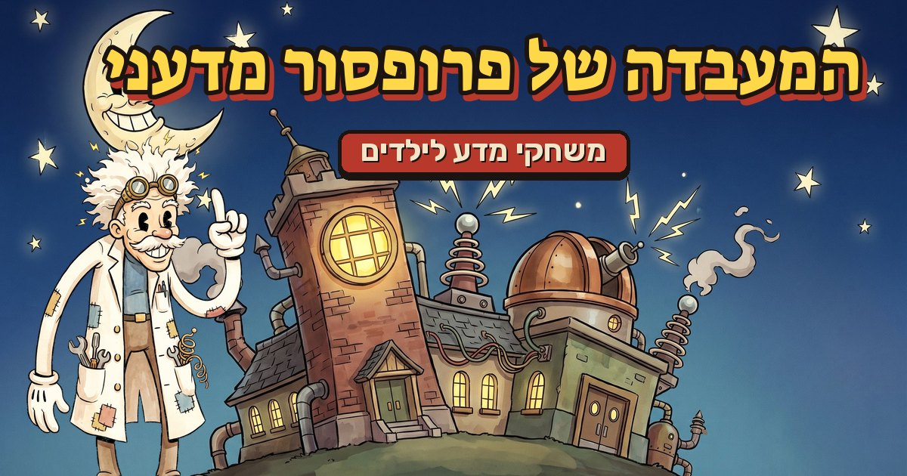
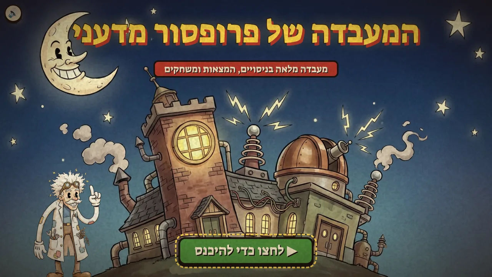
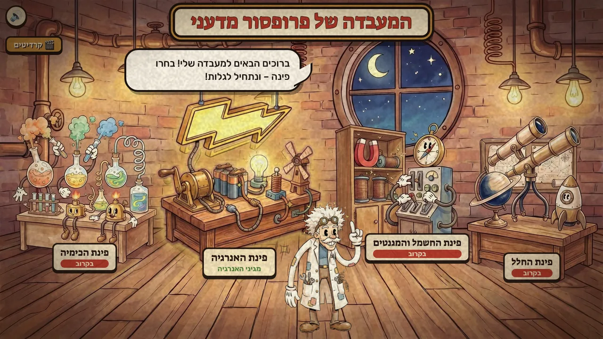
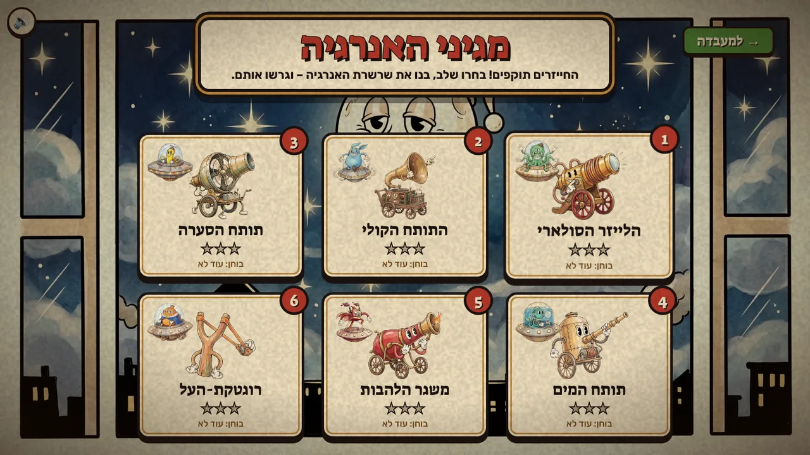
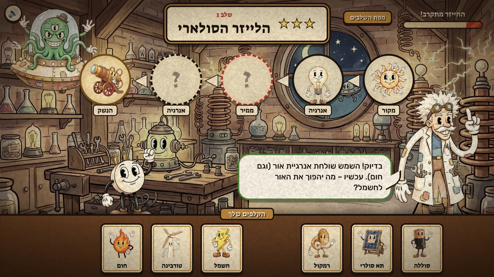
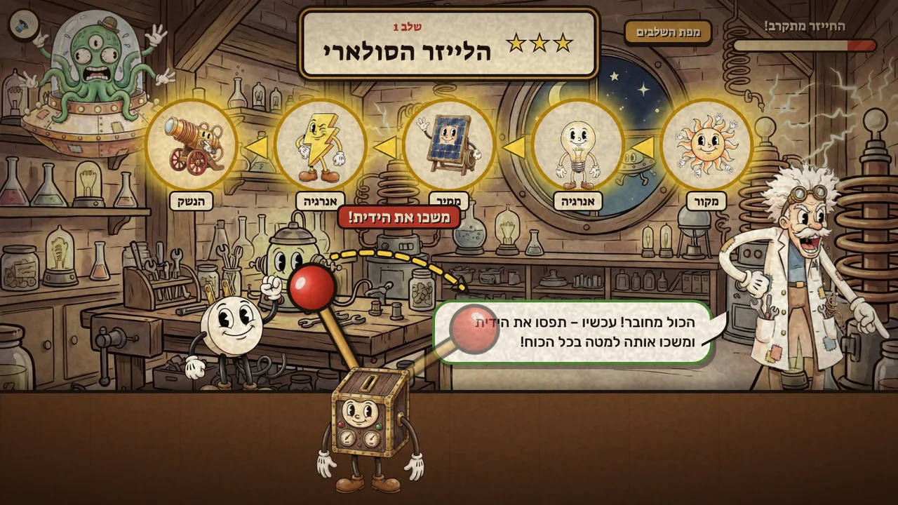
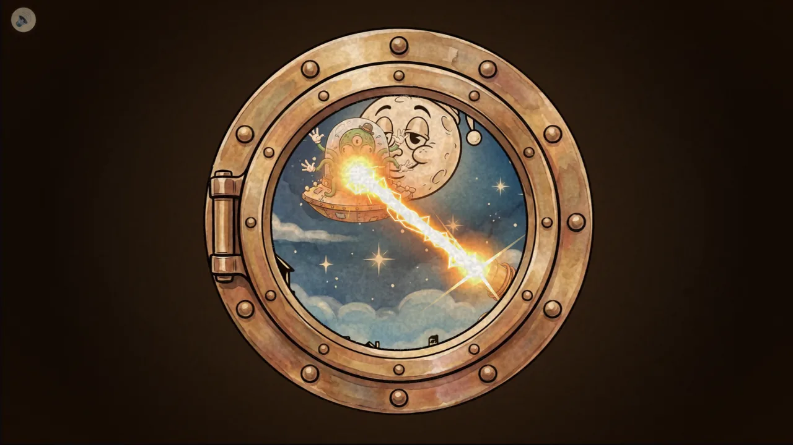
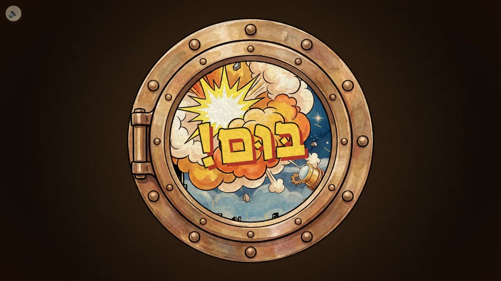
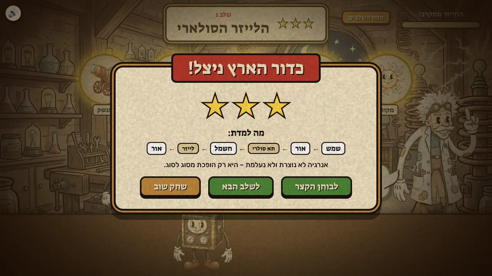
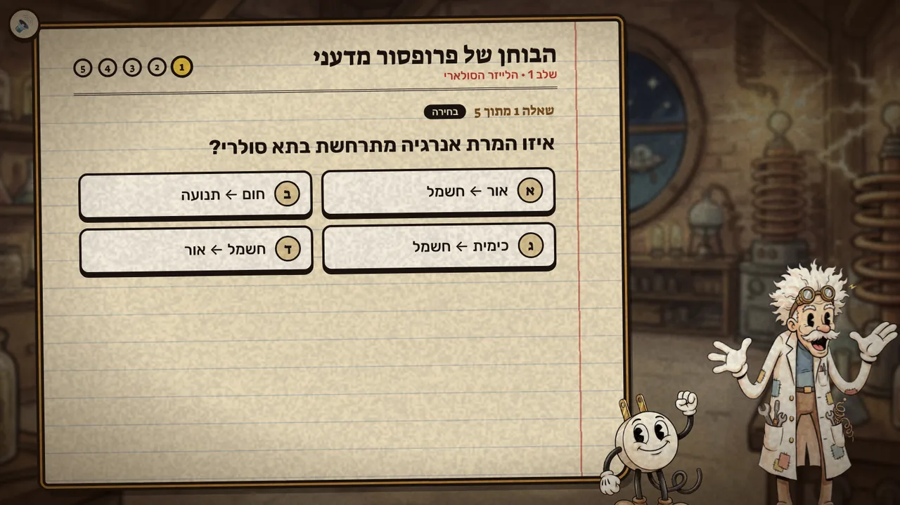

# המעבדה של פרופסור מדעני 🧪⚡

משחקי מדע בעברית לילדים, בסגנון סרטים מצוירים של שנות ה-30. נכנסים למעבדה של פרופסור מדעני, וכל פינה בה פותחת משחק אחר.

### ▶ [לשחק עכשיו](https://rotem-science-game.vercel.app/)

המשחק רץ בדפדפן, במחשב ובטלפון (עדיף לסובב את הטלפון לרוחב), בלי התקנה.



## המעבדה

אחרי מסך הפתיחה נכנסים למעבדה. פרופסור מדעני מקבל את פניכם, וכל פינה במעבדה מובילה למשחק: פינת האנרגיה פתוחה, ופינות הכימיה, החשמל והמגנטים והחלל יגיעו בקרוב. מי שמחכה יותר מדי בלי לבחור פינה יגלה שגם לפרופסור יש צרכים…

| | |
|:-:|:-:|
|  |  |
| מסך הפתיחה | המעבדה: הפינה שמצביעים עליה זוהרת |

## מגיני האנרגיה ⚡👽

המשחק הראשון מלמד על אנרגיה: סוגי אנרגיה, מקורות אנרגיה וממירים. חייזרים תוקפים את כדור הארץ, ובכל שלב בונים נשק נגדם. כדי שהנשק יעבוד, מרכיבים שרשרת של המרות אנרגיה מהקלפים: מקור ← אנרגיה ← ממיר ← אנרגיה ← הנשק. למשל, בשלב הראשון: שמש ← אור ← תא סולרי ← חשמל ← לייזר.

הפרופסור מסביר כל צעד בקול, וכל טעות עולה בכוכב. כשהשרשרת שלמה מושכים את הידית, ודרך החלון רואים את הנשק מגרש את החייזר.

יש שישה שלבים, ולכל אחד חייזר ונשק משלו: הלייזר הסולארי, התותח הקולי, תותח הסערה, תותח המים, משגר הלהבות ורוגטקת-העל.

| | |
|:-:|:-:|
|  |  |
| מפת השלבים | בונים את שרשרת האנרגיה |
|  |  |
| השרשרת שלמה: מושכים את הידית! | הלייזר יוצא לפעולה |
|  |  |
| בּוּם! | כדור הארץ ניצל, עם סיכום של מה שלמדנו |

### הבוחן של פרופסור מדעני

אחרי כל שלב אפשר לענות על בוחן קצר של חמש שאלות: שאלות בחירה, סידור שרשרת לפי הסדר, ושאלה פתוחה שבה משווים את התשובה שלכם לתשובה של הפרופסור. הכוכבים והציונים נשמרים בדפדפן ומופיעים במפת השלבים.



---

# למפתחים

המשחק כתוב ב-HTML, CSS ו-JavaScript רגילים, בלי ספריות ובלי שלב בנייה. הקוד נמצא ב-`game/`, והאתר מתארח ב-Vercel ומתעדכן מכל דחיפה ל-`main`. הכלים לייצור הגרפיקה, הצלילים והקריינות כתובים ב-Python ונמצאים ב-`tools/`, והבדיקות (pytest) ב-`tests/`:

```bash
python3 -m pytest
```

### לא צריך מפתחות API
כדי לשחק, להריץ את המשחק מקומית, לשנות את הקוד או להריץ את הבדיקות לא צריך שום מפתח ושום חשבון. כל הגרפיקה, הצלילים, המוזיקה והקריינות כבר שמורים בריפו (ב-`assets/`), והמשחק לא פונה לשום שירות חיצוני מלבד הגופנים של Google Fonts.

Gemini, ElevenLabs ו-Suno שימשו רק ליצירת הנכסים האלה. המפתחות `GEMINI_API_KEY` ו-`ELEVENLABS_API_KEY` נחוצים רק למי שרוצה ליצור גרפיקה, צלילים או קריינות חדשים, עם הכלים שמתוארים בהמשך. הכלים שרק מעבדים נכסים קיימים לא צריכים מפתח: `optimize_images.py`, `make_share_images.py`, `prepare_music.py` ו-`cut_lab_layers.py --reuse`.

## הרצה
מגישים את התיקייה עם שרת מקומי ופותחים את `game/index.html`:

```bash
python3 -m http.server 8000
# http://localhost:8000/game/
```

המשחק הוא עמוד אחד (כדי שהצלילים לא ייקטעו בין מסכים), אבל לכל מסך יש כתובת משלו: `#lab`, `#energy`, `#credits`. אפשר לשלוח קישור ישיר, וכפתור "חזרה" בדפדפן עובר בין המסכים. מסך הפתיחה תמיד מופיע ראשון, כי הדפדפן לא משמיע צלילים לפני הקשה ראשונה.

## הפינות במעבדה
המעבדה היא איור אחד שלם (`assets/art/lab_hub.jpg`). כל פינה נגזרת מתוכו לשכבה נפרדת שמונחת בדיוק מעל האיור, כך שבמנוחה רואים תמונה אחת. כשהעכבר מצביע על פינה, רק השכבה שלה זזה וזוהרת.
הפינות מוגדרות ב-`LAB_CORNERS` שב-`game/lab.js`. כדי להוסיף משחק מוסיפים לפינה מסך `open`. פינה בלי `open` מוצגת כ"בקרוב".

```bash
python3 tools/generate_assets.py lab_hub     # האיור המלא
python3 tools/cut_lab_layers.py              # גזירת הפינות (Gemini מסמן כל פינה, והגזירה נעשית מהאיור המקורי)
python3 tools/cut_lab_layers.py --reuse      # גזירה מחדש מהמסכות השמורות, בלי קריאות API
```

## ייצור גרפיקה
הגרפיקה נוצרה עם Gemini (`gemini-3-pro-image`), והיא כבר בריפו. רק כדי ליצור גרפיקה חדשה צריך להגדיר את המשתנה `GEMINI_API_KEY` בסביבה.

```bash
python3 tools/generate_assets.py            # רק נכסים חסרים
python3 tools/generate_assets.py sparky     # נכס מסוים
python3 tools/generate_assets.py --force    # הכול מחדש
```

הספרייטים נוצרים על רקע מג'נטה, והסקריפט מסיר את הרקע אוטומטית. הקבצים נשמרים ב-`assets/art/`.

הקבצים ב-`assets/art/` הם המקור (גדולים, ולא עולים לאתר). המשחק טוען עותקי WebP קטנים מ-`assets/web/`, ולכן אחרי כל שינוי בגרפיקה מריצים את הסקריפט הבא ומעלים גם את `assets/web/`:

```bash
python3 tools/optimize_images.py            # רק תמונות חדשות או ששונו
python3 tools/optimize_images.py --force    # הכול מחדש
```

## שיתוף וחיפוש
התמונה שמופיעה כששולחים קישור למשחק (וואטסאפ, פייסבוק וכו'), האייקונים וה-favicon נוצרים מהאיורים ומהגופנים של המשחק:

```bash
python3 tools/make_share_images.py          # assets/share/ ו-favicon.ico
```

הטקסטים לשיתוף ולמנועי חיפוש נמצאים ב-`<head>` של `game/index.html`. אם משנים את הכותרת, משנים אותה גם ב-`TITLE` שבסקריפט ומריצים אותו מחדש. הכתובת של האתר (`rotem-science-game.vercel.app`) כתובה גם ב-`robots.txt` וב-`sitemap.xml`.


## ייצור צלילים
אפקטי הקול במשחק נוצרו ב-ElevenLabs (יצירת צלילים מטקסט), והם כבר שמורים ב-`assets/sfx/` כ-MP3. מפתח של ElevenLabs צריך רק כדי ליצור צלילים חדשים. לכל צליל יש שתי גרסאות, והמשחק בוחר אחת באקראי ומשנה מעט את הגובה בכל השמעה, כדי שצלילים חוזרים לא יישמעו זהים. הרשימה נמצאת ב-`assets/sfx/variants.json`.

הפרומפטים נמצאים ב-`tools/sfx_manifest.json`. `tools/fetch_sounds.py` מייצר את הצלילים (דורש `ELEVENLABS_API_KEY`, ומנוי בתשלום לשימוש מסחרי), חותך שקט, ממיר למונו 44.1kHz ומאזן עוצמה. התוצאות נשמרות ב-`assets/sfx_candidates/`:

```bash
python3 tools/fetch_sounds.py elevenlabs boom        # צליל חסר או מסוים
python3 tools/fetch_sounds.py elevenlabs --force     # עיבוד מחדש מהמטמון, בלי קריאות API
python3 tools/fetch_sounds.py elevenlabs boom --refetch   # יצירה חדשה (עולה קרדיטים)
python3 tools/fetch_sounds.py promote elevenlabs     # העברה למשחק (MP3 + variants.json)
```

אפשר גם להביא חלופות בקוד פתוח מ-Kenney (רישיון CC0): `python3 tools/fetch_sounds.py kenney`. את כל הגרסאות אפשר להשוות ב-`game/sfx_compare.html`.

לפינת הכימיה (העכברוש והגבינה) יש צלילים משלה, שמתחילים ב-`m_`: טפטוף, רחש הקרח הנמס, לחישת הנר כשהוא נכבה, חריקת המאזניים, נפילת הגשר וקולות העכברוש. `promote` מעדכן ב-`variants.json` רק את הצלילים שנשלחו לו, כך שאפשר להוסיף צלילים חדשים בלי לקודד מחדש את כל השאר.

הצלילים המסונתזים הישנים (`tools/generate_sounds.py`) נשמרו ב-`assets/sfx_synth/` לצורך השוואה.

כפתור 🔊 בפינת המסך משתיק ומחזיר את הצלילים.

## מוזיקה
שני קטעי רקע נוצרו ב-Suno. המקורות שמורים ב-`assets/music_src/`:
- `suno_lab_2.mp3` מתנגן בלולאה בחדר המעבדה ובמפת השלבים, אבל לא בתוך השלב עצמו.
- `suno_lab_1.mp3` מלווה את מסך הקרדיטים.

`tools/prepare_music.py` הופך כל קטע ללולאה חלקה: 2 השניות האחרונות מתמזגות בתחילת הקטע. הסקריפט גם מאזן עוצמה ושומר את הקבצים ב-`assets/music/`:

```bash
python3 tools/prepare_music.py
```

המוזיקה יורדת בעוצמה בזמן שהפרופסור מדבר. במעבדה מתנגנים גם צלילי אווירה אקראיים מ-ElevenLabs, כמו בעבוע, ניצוצות וקיטור (`amb_*` ב-`tools/sfx_manifest.json`), מכיוון הפינה שאליה הם שייכים.

## קריינות
פרופסור מדעני מדבר בקול "Crazy Scientist" מ-ElevenLabs (מודל `eleven_v3`, שתומך בעברית). כל ההקלטות כבר שמורות בריפו. רק כדי להקליט שורות חדשות או ששונו צריך להגדיר את המשתנה `ELEVENLABS_API_KEY` בסביבה.
הטקסטים נלקחים ישירות מ-`game/levels.js`, מ-`game/lab.js` ומ-`game/mouse_levels.js` (דרך node), והקבצים נשמרים ב-`assets/voice/`.

```bash
python3 tools/generate_voice.py             # רק שורות חדשות או שהשתנו
python3 tools/generate_voice.py intro_1     # שורה מסוימת
python3 tools/generate_voice.py --force     # הכול מחדש
python3 tools/generate_voice.py --list      # הצגת כל השורות בלי להקליט
```

`assets/voice/manifest.json` שומר את הטקסט שממנו הוקלטה כל שורה, כך שעריכת שורה ב-`levels.js` והרצה חוזרת מקליטות רק אותה.

### ניקוד
מילים שהקול נוטה לקרוא לא נכון (למשל "אגורה", שבלי ניקוד נקראת כמו המטבע) מקבלות ניקוד מ-`tools/voice_niqqud.json`. הניקוד נשלח רק ל-ElevenLabs, ובבועת הדיבור הטקסט נשאר בלי ניקוד. כל צורה של מילה היא ערך נפרד, כולל התחיליות ("סוללה", "בסוללה", "הסוללה"). כשמוסיפים או משנים מילה, כל השורות שהיא מופיעה בהן יוקלטו מחדש בהרצה הבאה.

לפני שמקליטים, אפשר לבדוק את הניקוד בעמוד אחד:

```bash
python3 tools/generate_voice.py --review    # docs/voice_niqqud_review.md: המילים, וכל שורה כפי שהקול יקבל אותה
```
